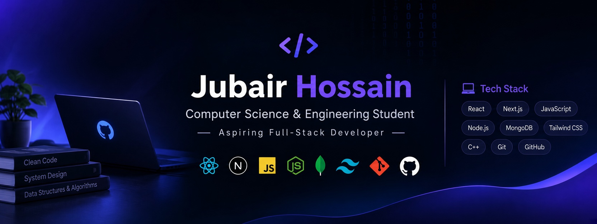

  

# Hi, I'm Jubair Hossain 👋

### Computer Science & Engineering Student | Aspiring Full-Stack Developer

Welcome to my GitHub profile!

I'm a Computer Science and Engineering student passionate about software development, problem-solving, and exploring new technologies.

## 🚀 About Me

- 🎓 Studying Computer Science & Engineering
- 💻 Exploring Full-Stack Web Development
- 🌱 Currently learning Next.js, MongoDB and modern web technologies
- 🧠 Interested in Artificial Intelligence, Machine Learning and Cybersecurity
- ⚡ Practicing Data Structures and Algorithms

## 💻 Tech Stack

### 👨‍💻 Programming Languages

 

### 🎨 Frontend Development

  

### ⚙️ Backend & Database

  

### 🛠️ Tools & Platforms

  

## 📫 Connect With Me

 
## 🌐 Connect With Me

  

  

  

  

## 📊 GitHub Statistics
 

  
  

## 🔥 GitHub Contribution Streak

  

## 🚀 Featured Projects

### 📚 Library Management System

A web-based library management system for managing books, borrowing, and returning operations.

**Technologies:** Next.js, MongoDB

🌐 [Live Demo](https://project-seven-pearl-59.vercel.app/)

💻 [GitHub Repository](https://github.com/jubairhs115-cell/project)

---

### 💪 FitLog — Fitness Tracking Application

A fitness application designed to explore exercises and track workout information.

**Technologies:** Next.js, TypeScript, Tailwind CSS

💻 [GitHub Repository](https://github.com/jubairhs115-cell/my-gym-project)
⭐ Thanks for visiting my profile!

 
